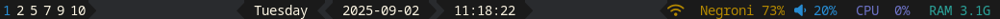

# My Dotfiles

These are my dotfiles for Fedora Linux with Sway window manager. 
They work for me and my workflow. 
They may not work for you and your workflow. 
Dotfiles are very personal. 
I recommend against copying anyone's dotfiles directly and in favour of looking at the screenshots, reading the files, and deciding what would work for you. 
I also recommend looking at other people's dotfiles and see how they solve the same problems.

## Details

* **OS**: [Fedora](https://www.fedoraproject.org)
* **Window manager**: [Sway](https://www.github.com/swaywm/sway)
* **Status bar**: [Waybar](https://www.github.com/Alexays/Waybar)
* **Notifications**: [Dunst](https://www.github.com/dunst-project/dunst)
* **Terminal**: [Foot](https://www.github.com/alacritty/alacritty)
* **Editor**: [Neovim](https://www.github.com/neovim/Neovim)
* **IDE**: None
* **File manager**: [Yazi](https://www.github.com/sxyyazi/yazi)
* **Spotify client**: [spotify_player](https://www.github.com/aome510/spotify-player)
* **Browser**: Firefox
* **DB Client**: [Rainfrog](https://github.com/achristmascarl/rainfrog)
* **CSV Reader**: [csvlens](https://www.github.com/YS-L/csvlens)

## Screenshots

Basic state:


Status bar:


The date is centred on screen but appears off-centre here to keep all elements readable.

## Installation

The files are set up in `~/software/dotfiles_desktop/config`

### Install GitHub

Everything is saved and linked to GitHub.

Install gh (GitHub client):

```bash
sudo dnf install gh -y
```

Run this to create auth tokens (it will automatically open a browser to authenticate):
```bash
gh auth login --hostname github.com --git-protocol ssh --web --skip-ssh-key
```

Install gh milestone extension:

```bash
gh extension install valeriobelli/gh-milestone
```

### Set up Git

Create an ssh key for Github:

```bash
mkdir -p ~/.ssh
chmod 700 ~/.ssh
[ -f ~/.ssh/github_david_manning ] || ssh-keygen -t ed25519 -C "$(hostname)" -f ~/.ssh/github_david_manning
```

Print the **public** key:
```bash
cat ~/.ssh/github_david_manning.pub
```

Upload the **public** key to Github.
Go to https://github.com/settings/keys and click New SSH Key.
Pick a suitable title, add the key as an Authentication Key.

### Install dotfiles

Create the software directory and clone the repo:
```bash
mkdir -p ~/software
git clone https://github.com/David-Manning/dotfiles_desktop ~/software/dotfiles_desktop
```

Run the bootstrap script:

```
cd ~/software/dotfiles_desktop
./bootstrap.sh
```

### Make zsh the default

The bootstrap installs zsh but does not make it the login shell, because that asks for a password. Once the bootstrap has finished, run this and then log out and back in:

```bash
chsh -s /usr/bin/zsh
```

### Install Julia

The Julia script is not called by the bootstrap. Run it by hand from `scripts/bootstrap/languages/` if needed.

### Install Printer

This sets up the Brother HL-L3230CDW. First check the printer is visible on the network:

```bash
sudo lpinfo -v | grep HL-L3230CDW
```

If it is listed, install the Brother driver (this provides the PPD used below):

```bash
curl -fsSL https://download.brother.com/welcome/dlf103944/hll3230cdwpdrv-1.0.2-0.i386.rpm -o /tmp/hll3230cdwpdrv-1.0.2-0.i386.rpm
sudo dnf install -y /tmp/hll3230cdwpdrv-1.0.2-0.i386.rpm
rm -f /tmp/hll3230cdwpdrv-1.0.2-0.i386.rpm
```

Add the printer with A4 paper and two-sided printing, then make it the default:

```bash
sudo lpadmin -p HLL3230CDW \
    -E \
    -v "ipp://Brother%20HL-L3230CDW%20series._ipp._tcp.local/" \
    -m "Brother/brother_hll3230cdw_printer_en.ppd" \
    -o media=a4 \
    -o sides=two-sided-long-edge
sudo lpoptions -d HLL3230CDW
```

### Install Firefox
1. Open `about:profiles` in Firefox. Find the profile marked "This is the profile in use" and copy its Root Directory.
2. Close Firefox.
3. Link `user.js` into that folder, replacing `<root directory>` with the path you copied:

```sh
ln -s ~/software/dotfiles_desktop/config/firefox/user.js <root directory>/user.js
```

### Stan Syntax Highlighting

If Stan syntax highlighting is not working, run these:

* Clone `https://github.com/WardBrian/tree-sitter-stan into ~/software/tree-sitter-stan/`.
* Run `tree-sitter build --output ~/.local/share/nvim/site/parser/stan.so ~/software/tree-sitter-stan/grammars/stan/`.
* Run `install_stan_queries.zsh` to pull the `.scm` files.

To install treesitter, run `npm install -g tree-sitter-cli`. On Windows, you will also need to install Visual Studio Build Tools to compile C code.

## Licence

This project is licensed under the MIT Licence - see the [LICENSE](LICENSE) file for details.


